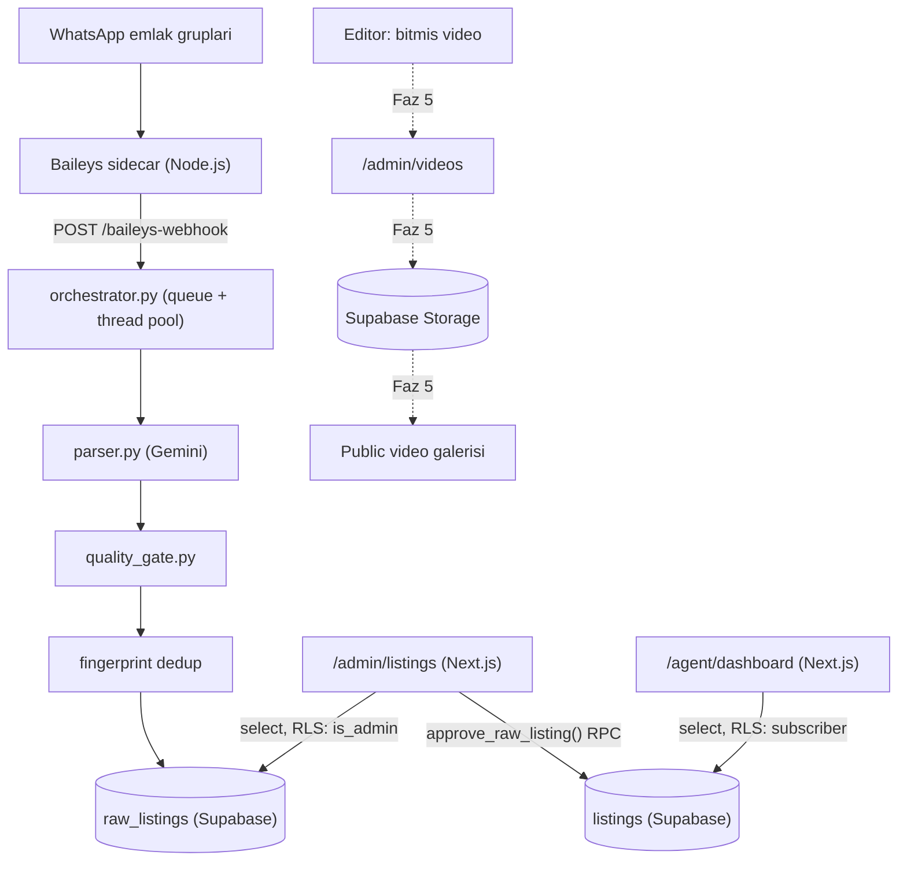

# Sistem Mimarisi

Şu ana kadar kurulan veri akışı (Faz 1-3).

**Notlar**
- Kesikli oklar (Faz 5) henüz kurulmadı, planlanan akışı gösteriyor.
- `approve_raw_listing()` / `reject_raw_listing()` Postgres fonksiyonları `SECURITY INVOKER` — admin yetkisi fonksiyon içinde değil, RLS politikalarında (`supabase/migrations/0002_admin_review.sql`).
- Dedup üç katmanlı: Baileys sidecar'daki bellek-içi `_active_ids` seti, `fingerprint` kolonu üzerindeki kontrol, `raw_listings.source_message_id` üzerindeki unique index.
