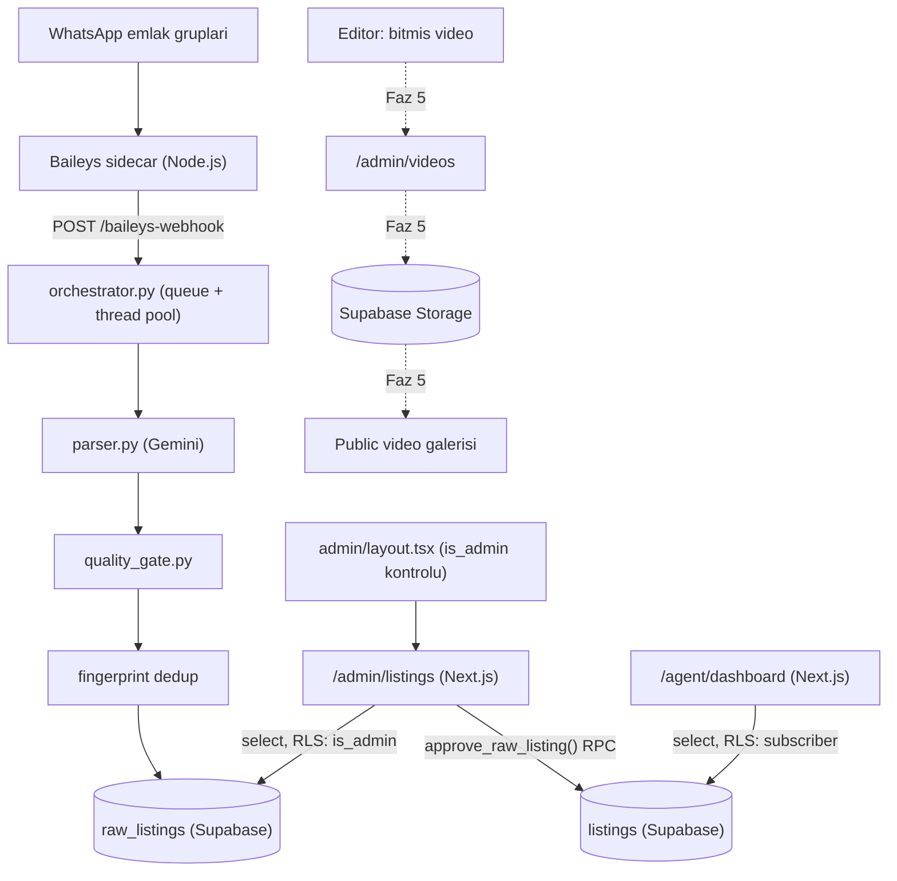
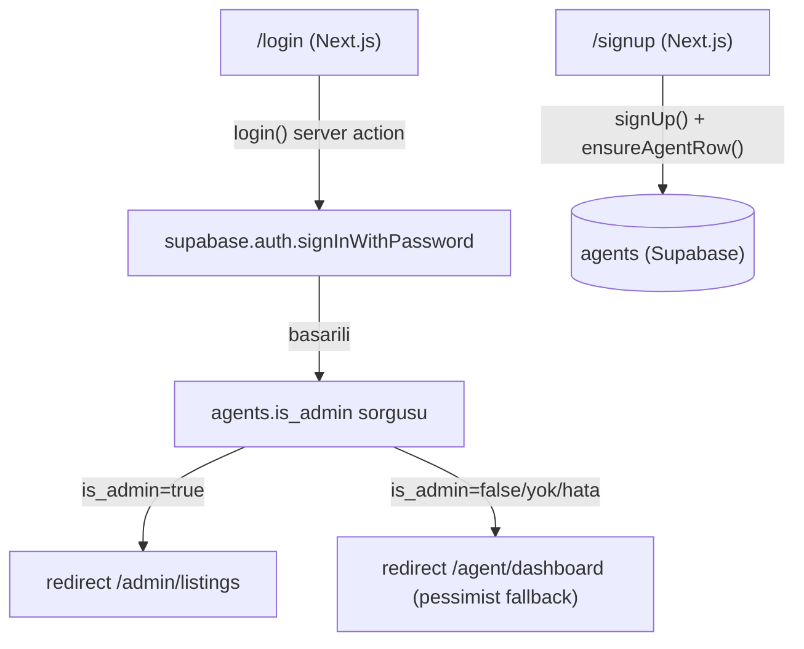
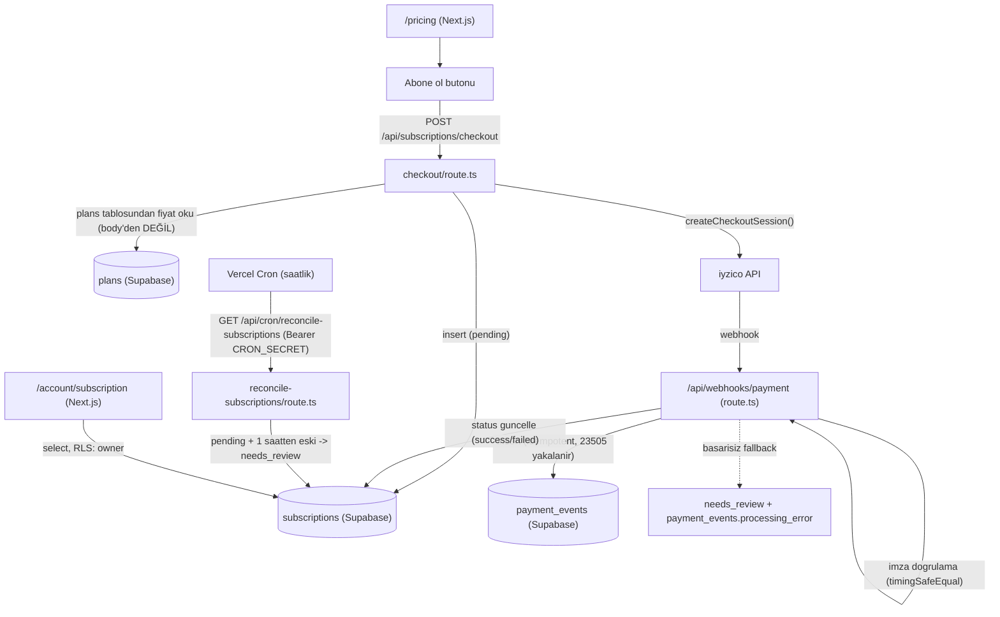

# Sistem Mimarisi

## 1. Veri akışı: WhatsApp'tan onaylı ilana (Faz 1-3)

**Notlar**
- Kesikli oklar (Faz 5) henüz kurulmadı, planlanan akışı gösteriyor.
- `approve_raw_listing()` / `reject_raw_listing()` Postgres fonksiyonları `SECURITY INVOKER` — admin yetkisi fonksiyon içinde değil, RLS politikalarında (`supabase/migrations/0002_admin_review.sql`).
- Dedup üç katmanlı: Baileys sidecar'daki bellek-içi `_active_ids` seti, `fingerprint` kolonu üzerindeki (partial) unique index (`supabase/migrations/0007_raw_listings_fingerprint_unique.sql`), `raw_listings.source_message_id` üzerindeki unique index.
- `admin/layout.tsx` ile `admin/listings/page.tsx`'in authz davranışı KASITLI olarak farklı: layout, admin olmayanı `notFound()` ile (kaynağın varlığını sızdırmadan) karşılar; page, kendi `requireAdmin()` kontrolünde oturumsuzu `/login`'e, admin-olmayanı `/agent/dashboard`'a yönlendirir — iki ayrı savunma katmanı (defense-in-depth), birbirinin yedeği.

## 2. Kimlik doğrulama ve rol yönlendirmesi

**Notlar**
- `login()` (`web/src/app/login/actions.ts`) rol yönlendirmesinde **pessimist** davranır: `agents` sorgusu başarısız olursa (ağ hatası, satır yok) admin'e değil `/agent/dashboard`'a yönlendirir — yanlışlıkla admin paneline düşürmemek için.
- `company_name` dolu bir `user_metadata` ile giriş yapan kullanıcı için `ensureAgentRow()` çağrılır (agent kaydı yoksa oluşturur); boşsa çağrılmaz.
- `admin/layout.tsx` login akışından bağımsız, her `/admin/*` isteğinde kendi başına tekrar doğrular (savunma derinliği — bkz. bölüm 1 notu).

## 3. Abonelik ve ödeme (iyzico)

**Notlar**
- Checkout rotası, istemciden gelen fiyatı asla kullanmaz — fiyat her zaman `plans` tablosundan okunur (manipülasyonu önlemek için).
- Checkout rotasında kullanıcı bazlı in-memory rate-limit var (`RATE_LIMIT_MAX_REQUESTS=10` / 10s) — tek instance'ta geçerli, çoklu instance/serverless cold-start'ta sıfırlanabilir, bilinen bir sınırlama.
- Webhook rotası `payment_events`'e idempotent insert yapar (aynı event tekrar gelirse 23505 ile yakalanıp duplicate olarak işaretlenir), sonra `subscriptions.status`'u günceller; update 0 satır etkilerse (satır bulunamadı/uyumsuz durum) `needs_review`'a düşer, bu da başarısız olursa `payment_events.processing_error=true` ile işaretlenip 500 döner (çok seviyeli fallback, `web/src/app/api/webhooks/payment/route.ts`).
- `reconcile-subscriptions` cron job'u, webhook hiç gelmeyen (sağlayıcı tarafı sessiz kalan) `pending` kayıtları 1 saat sonra `needs_review`'a çekerek "sonsuza kadar pending kalma" riskini kapatır — `CRON_SECRET` ile korunur, secret tanımlı değilse `500 CONFIG_ERROR` döner (401 ile ayrıştırılır, "secret yanlış" ile "secret hiç yok" karışmaz).

## Veritabanı şeması (migration geçmişi)
| Migration | İçerik |
|---|---|
| `0001_init.sql` | `agents`, `raw_listings`, `listings` temel şema + RLS |
| `0002_admin_review.sql` | `approve_raw_listing()`/`reject_raw_listing()` RPC'leri (SECURITY INVOKER) |
| `0003_subscriptions_payment.sql` | `plans`, `subscriptions`, `payment_events` tabloları |
| `0004_fix_agents_self_update_rls.sql` | `agents` self-update RLS düzeltmesi |
| `0004_payment_events_processing_error.sql` | `payment_events.processing_error` kolonu |
| `0005_agents_immutable_columns.sql` | `agents`'ta değiştirilemez kolon kısıtı |
| `0006_plans_sort_order.sql` | `plans.sort_order` kolonu |
| `0006_agents_self_insert.sql` | `agents` self-insert RLS |
| `0007_raw_listings_fingerprint_unique.sql` | `fingerprint` üzerinde partial unique index (dedup atomikleştirme) |

Not: `0004` ve `0006` numaraları iki farklı dosyada tekrar ediyor (sıralı numaralandırma disiplini bir noktada kaymış) — uygulama sırası dosya adına göre değil gerçek `supabase/migrations/` dizin listesine göre değerlendirilmeli, bu doküman sadece içerik envanteri verir.

## Sayfa/route envanteri (gerçek kod, 2026-10-23 itibarıyla)
- `/` (`web/src/app/page.tsx`)
- `/login` (`web/src/app/login/page.tsx` + `actions.ts`)
- `/signup` (`web/src/app/signup/page.tsx`)
- `/pricing` (`web/src/app/pricing/page.tsx`)
- `/account/subscription` (`web/src/app/account/subscription/page.tsx`)
- `/agent/dashboard` (`web/src/app/agent/dashboard/page.tsx`)
- `/admin/listings` (`web/src/app/admin/listings/page.tsx`, `admin/layout.tsx` ile korunur)
- `/admin/videos` (`web/src/app/admin/videos/page.tsx`, Faz 5 — planlanan akışın parçası, henüz storage/public galeri bağlantısı yok)
- `POST /api/subscriptions/checkout`
- `GET/PATCH /api/subscriptions/[id]`
- `POST /api/webhooks/payment`
- `GET /api/cron/reconcile-subscriptions`

## scraper/ modül envanteri
- `orchestrator.py` — queue + thread pool, mesaj işleme akışının merkezi.
- `parser.py` — Gemini ile ham metni yapılandırılmış ilana çevirir (429 key rotasyonu, `GeminiKeyManager`).
- `quality_gate.py` — kural-bazlı güven skoru (`score_listing`) + otomatik onay eşiği (`is_safe_to_auto_approve`).
- `fingerprint.py` — normalize edilmiş alanlardan deterministik sha256 dedup anahtarı.
- `supabase_client.py` — service-role REST çağrıları (RLS bypass), `insert_raw_listing` atomik 23505 yakalama deseni.
- `api_key_manager.py` — Gemini key havuzu, round-robin + cooldown.
- `sidecar/bridge.js` (Node.js) — Baileys WhatsApp köprüsü, grup filtresi (`isGroupJid`).
