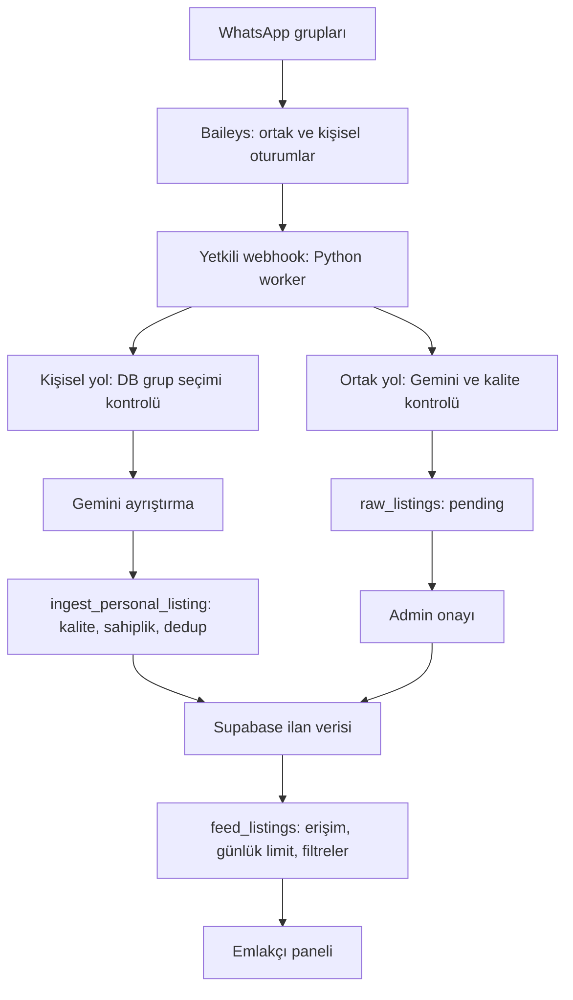

# Sistem Mimarisi

Son güncelleme: 31 Ekim 2026. Kaynak kod envanteridir; canlı dağıtım doğrulaması değildir.

## İlan akışı

- scraper/sidecar/bridge.js: grup filtresi, grup adı önbelleği, en fazla 3 webhook gönderim denemesi.
- scraper/sidecar/sessions/: kişisel QR, şifreli auth dosyaları, oturum yaşam döngüsü, grup senkronizasyonu, heartbeat.
- scraper/orchestrator.py: 10 worker ve bellek kuyruğu; kişisel webhook istekleri yalnız loopback üzerinden kabul edilir.
- Kişisel grup seçimi Gemini çağrısından önce DB'den doğrulanır. Kişisel kalite eşiği kararı DB RPC'sinde verilir. Ortak yol kayıtları admin onayına gönderir.
- Dedup aktif mesaj seti ve DB mesaj/fingerprint kısıtlarıyla yapılır; kişisel kapsam migration 0024'te düzenlenir.
- web/src/lib/listings-feed/: filtreler, 5 saniyelik sorgu zaman aşımı, okunmamış sayaç. Günlük limit ve kilitli alanların sınırlandırılması DB RPC'sindedir.

## Kimlik ve yetki

Supabase Auth oturumu web/src/proxy.ts üzerinden yenilenir. Giriş rol sorgusuna göre admin veya emlakçı paneline yönlendirir; rol doğrulanamazsa emlakçı paneli seçilir.

Admin layout ve ilgili sayfa/action kontrolleri ayrı yetki denetimi yapar. RLS ve RPC grant'leri veritabanı katmanını korur. Service-role yalnız sunucudaki ayrıcalıklı işlemlerde kullanılır. Her RPC'nin güvenlik modu ve yetkileri kendi migration'ından kontrol edilmelidir.

## Video siparişi

Emlakçı fotoğraf, ham video veya yerinde çekim seçer. Kaynak dosyaları özel Storage'a yükler ya da adres/zaman notu girer. Admin teklif verir, kaynakları indirir ve insan eliyle hazırlanan videoyu yükleyip teslim eder.

Durumlar: draft, quote_pending, awaiting_payment, payment_failed, in_progress, delivered, canceled. İzinli geçiş ve aktörler web/src/lib/video-orders/status.ts içindedir.

Hammadde bucket'ı video-order-assets, teslim bucket'ı property-videos. Dosyalar özel erişim ve imzalı bağlantılarla sunulur. Tür/adet/boyut kuralları limits.ts ve Storage migration'larında bulunur.

## Ödeme ve bildirim API'leri

| Rota | Görev |
|---|---|
| POST /api/subscriptions/checkout | Abonelik checkout |
| GET/PATCH /api/subscriptions/[id] | Abonelik okuma/güncelleme |
| POST /api/video-orders/[id]/checkout | Video ödemesi |
| POST /api/webhooks/payment | İmza kontrolü, event tekilleştirme, ödeme sonucu |
| GET /api/cron/reconcile-subscriptions | Saatlik: bir saatten eski pending abonelikleri needs_review yapar |
| GET /api/cron/push | Her 5 dakikada web push kontrolü/gönderimi |
| /auth/callback | Kimlik doğrulama callback'i |

Cron programları web/vercel.json içindedir; Bearer CRON_SECRET ile korunur. Reconcile rotası secret yoksa 500, yanlışsa 401 döner. Ödeme adaptörü web/src/lib/payments/iyzico.ts, push kodu web/src/lib/push/ içindedir.

## Şema

| Migration grubu | İçerik |
|---|---|
| 0001–0002 | Temel şema, RLS ve admin review |
| 0003–0010 | Abonelik/ödeme, agent korumaları, dedup, anonim plan okuma |
| 0011–0015 | Video erişimi, grup adı, video siparişi ve dosya kısıtları |
| 0016–0020 | İlan akışı, sayaçlar, RPC yetkileri, deneme/şartlar ve günlük limit |
| 0021–0022 | Push abonelikleri ve endpoint kontrolü |
| 0023–0024 | Kişisel WhatsApp, grup seçimi, kişisel ilanlar ve sayaçlar |

*.down.sql dosyaları geri alma içindir; ileri migration olarak uygulanmamalıdır. Canlı uygulama geçmişi ayrıca kontrol edilmelidir.

## Sınırlar

Bellek kuyruğu kalıcı değildir ve kapasite sınırı yoktur. Checkout hız sınırı süreç bazlıdır. Yerel testler gerçek servis entegrasyonlarını ve canlı RLS/Storage davranışını tek başına doğrulamaz. Ekran envanteri, kurulum ve test kaydı için [README](../README.md).

