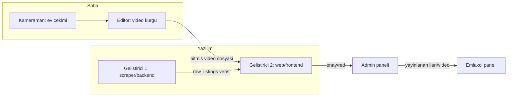

# Ekip İş Akışı

4 kişilik ekip (2 yazılımcı, 1 editör, 1 kameraman) arasındaki devir noktaları.

**Devir noktaları**
- Kameraman → Editör: ham çekim dosyası (format/süre standardı ekip içinde kararlaştırılmalı).
- Editör → Geliştirici 2: bitmiş video dosyası + hangi mülke ait olduğu bilgisi (Faz 5'te `/admin/videos` üzerinden yükleme akışı kurulacak).
- Geliştirici 1 → Geliştirici 2: `raw_listings` tablosu arayüzü (scraper backend yazar, web admin paneli okur) — ortak sözleşme şema dosyasında (`supabase/migrations/`).
- Admin paneli → Emlakçı paneli: sadece onaylanmış, abonelik kontrolünden geçen veri.

Görev kırılımı ve kimin hangi fazda ne yapacağı bu dosyada değil, ekibin kendi task panosunda (bkz. proje notları) tutulur — mimari burada sabit, iş dağılımı orada değişken.
